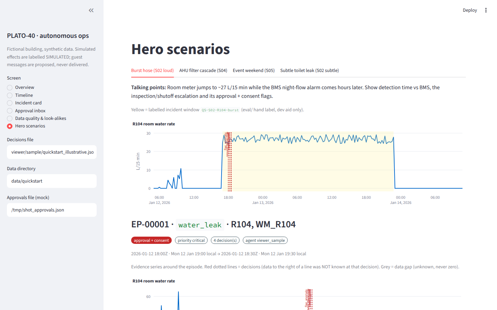
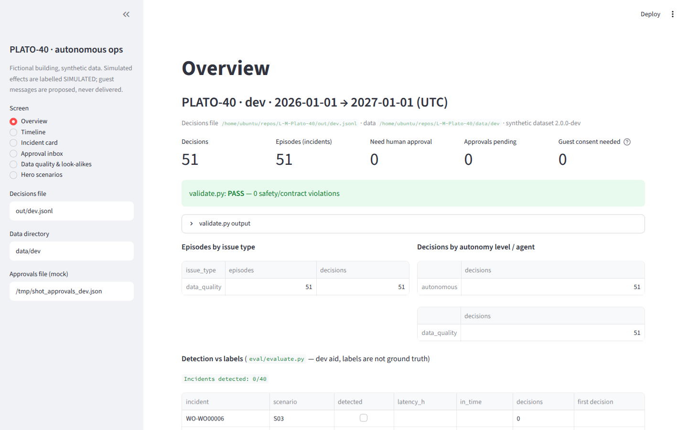

# L-M · PLATO-40 — autonomous building pipeline

Proximata Hackathon '26 · Systems for Built Space · Rhomberg track
("PLATO · CLARA Future — The Autonomous Building").

> **PLATO-40 is a fictional reference property.** All data is synthetic
> ("PLATO-40 synthetic dataset, Proximata Hackathon '26 – Rhomberg track", CC BY 4.0).
> Findings concern PLATO-40 only — not real PLATO buildings or CLARA. PLATO and CLARA
> are Rhomberg product names, used here only to refer to the challenge context.

A replay of one year of a 40-room self-check-in hotel. Domain agents detect problems,
decide within the autonomy rules, and write an auditable decision log
(`decisions.jsonl`) plus Level 3 feedback (`insights.md`).

## Run it (one command)

```bash
pip install -r requirements.txt
python run.py <data_dir> --out decisions.jsonl
python validate.py decisions.jsonl <data_dir>      # contract + safety check
```

`<data_dir>` is a dataset folder containing `manifest.json` (or its parent). The datasets are in the repo:

```bash
python run.py data/dev --out decisions.jsonl            # deliverable (365 days, ~30 s)
python run.py data/quickstart --out out/qs.jsonl        # development (21 days, ~1 s)
```

No API key needed — the pipeline is fully deterministic and offline.

With Docker:

```bash
docker build -t plato40 .
docker run --rm -v "$PWD/data:/data" plato40 /data/dev --out /data/out/decisions.jsonl
```

## Develop

```bash
pip install -r requirements-dev.txt
python -m pytest -q                                                   # tests
python eval/evaluate.py out/qs.jsonl --labels eval/labels_quickstart.json  # detection vs hand labels
python eval/evaluate.py decisions.jsonl --data data/dev               # weak labels from work orders/events
```

Documentation for the team and coding agents: [`AGENTS.md`](AGENTS.md) ·
[task brief](docs/TASK.md) · [data guide](docs/DATA.md) · [architecture](docs/ARCHITECTURE.md) ·
[plan & ticket board](docs/PLAN.md) · [decisions](docs/DECISIONS.md) · [tickets](docs/tasks/) · [Devin guide](docs/DEVIN.md).

## Viewer

Streamlit demo viewer for the live demo: evidence → risk → decision → autonomy → verification
(overview + `validate.py`/`evaluate.py` results, timeline, incident cards with evidence charts, mock approval
inbox, data quality & look-alikes, four quickstart hero incidents). Click paths: [`docs/DEMO.md`](docs/DEMO.md).

```bash
pip install -r viewer/requirements.txt
python run.py data/quickstart --out out/qs.jsonl
streamlit run viewer/app.py -- --decisions out/qs.jsonl --data data/quickstart    # http://localhost:8501
docker compose up --build viewer                                                  # same, on a server (port 8501)
```

Read-only over a decisions file. Guest messages are shown as **PROPOSED — not delivered**, simulated effects
as **SIMULATED**, data gaps shaded as unknown; Approve/Reject only writes `out/approvals.json` (mock executor).
`viewer/sample/quickstart_illustrative.jsonl` (`python viewer/sample_decisions.py`) is an *illustrative*
hand-placed sample for rehearsing the hero screens — not pipeline output.




## Holdout (Saturday ~11:00)

Full runbook: [`docs/RELEASE.md`](docs/RELEASE.md). Release check first (fresh clone → venv → tests →
dev run → validate → eval → root deliverables; exits non-zero on any failure, < 5 min):

```bash
scripts/release_check.sh --copy-back          # Windows: powershell -ExecutionPolicy Bypass -File scripts\release_check.ps1 -CopyBack
```

```bash
git tag pre-holdout && git push origin pre-holdout          # BEFORE the release
7z x -p'<password>' data/raw/PLATO40_v2_holdout_encrypted.7z -odata/holdout
python run.py data/holdout --out decisions_holdout.jsonl     # code unchanged
python validate.py decisions_holdout.jsonl data/holdout
git add decisions_holdout.jsonl && git commit -m "Holdout run" && git push
```

### Changes after pre-holdout
_None yet. Any change after the tag must be justified here (separate commit each; re-run the holdout afterwards):_

| Commit | What changed | Why it was unavoidable | Effect on `decisions_holdout.jsonl` |
|---|---|---|---|
| — | — | — | — |

## Architecture

```
data_dir ─► io.load (clean, log DQ) ─► State (stays, housekeeping, roster)
                                         │
              engine.run: clock steps 15 min through the year
                                         │
   ┌───────────────┬──────────────┬──────┴───────┬───────────────┬──────────────┐
 data_quality   turnaround(S01)  water(S02)   comfort(S03)   maintenance(S04) …surge(S05), energy, logistics
   └───────────────┴──────────────┴──────┬───────┴───────────────┴──────────────┘
                                         ▼
                 decision.make_decision (autonomy policy) ─► DecisionLog (episodes)
                                         ▼
                        decisions.jsonl ─► validate.py ─► viewer
```

| Module | Role |
|---|---|
| `plato40/io.py` | Load all files, UTC parsing, cleaning + data-quality log |
| `plato40/asof.py` | **As-of views** — only information known at time *t* (tariff by `published_utc`, forecast by `issued_utc`, roster by `status_known_utc`, work orders by `created_utc`) |
| `plato40/state.py` | Stays from events, housekeeping state, staff/robot/on-call availability, release preconditions |
| `plato40/decision.py` | Decision record + **autonomy policy** (approval / consent derived from the action, never set by hand) |
| `plato40/log.py` | Decision log with **episodes** (one incident = one detection, no alert spam) |
| `plato40/engine.py` | Replay clock + detector interface |
| `plato40/detectors/` | One domain agent per file |
| `validate.py` | Contract + safety validator |

### Safety guarantees (CHALLENGE §7)

- `requires_human_approval` / `requires_guest_consent` are computed by `decision.autonomy_level`
  from the action and context, and can only be made stricter.
- `release_room` only when `State.can_release` (vacant, `clean`, not blocked).
- Staff/robots only when `State.available` says they are on shift *as known at decision time*.
- Consent required ≠ consent granted; proposed guest messages (`message`) are never claimed as delivered.
- Simulated effects are labelled in `simulated_effect`.
- `validate.py` checks all of the above on any output file and exits non-zero on a violation.

### Writing a detector

Subclass `TriggerDetector` (see `plato40/detectors/data_quality.py`):

1. `build_triggers(data, state)` — compute **causal** features (backward-looking only) and yield
   `(timestamp, kind, payload)` at the moment the information became available.
2. `handle(ctx, ts, kind, payload)` — decide; use `ctx.asof` and `ctx.state`; add decisions with
   `ctx.log.add(make_decision(...), episode_key=...)`. One episode per incident; follow-ups only on change.

## Decision contract

Required and optional fields as in `DECISION_CONTRACT.md` v2. Extension fields:

| Field | Meaning |
|---|---|
| `scheduled_for_utc` | When the action should happen (e.g. cleaning slot) |
| `message` | Proposed guest message `{language, text, source: template\|llm}` — not a delivery |
| `simulated_effect` | Labelled simulated outcome |
| `agent` | Domain agent that produced the decision |

Extra actions (beyond the vocabulary): `water_shutoff` (approval + consent),
`call_oncall_housekeeper` (approval, notable cost).

## Data cleaning assumptions

Data: `data/` (CC BY 4.0, see `data/README.md`). Never concatenate quickstart and dev.


- Empty = missing, never zero. Telemetry gaps ≥ 2 h are flagged; ≥ 3 rooms on one floor → gateway episode.
- Implausible values → NaN (temperature outside −5…45 °C, humidity 0…100 %, CO₂ 250…10 000 ppm).
- Water meters: consumption between consecutive valid readings; negative step > 50 L = meter reset
  (consumption unknown for that step); smaller negative steps = jitter (clipped to 0).
- Duplicate keys dropped (first kept). All cleaning is listed in `<out>_dq.json`.

## Environment

Python ≥ 3.11, pandas, numpy. Optional LLM wording via `.env` (see `.env.example`) — the
pipeline must and does run without it.

## Licence

Code: MIT (see `LICENSE`). Data: CC BY 4.0, attribution above.
