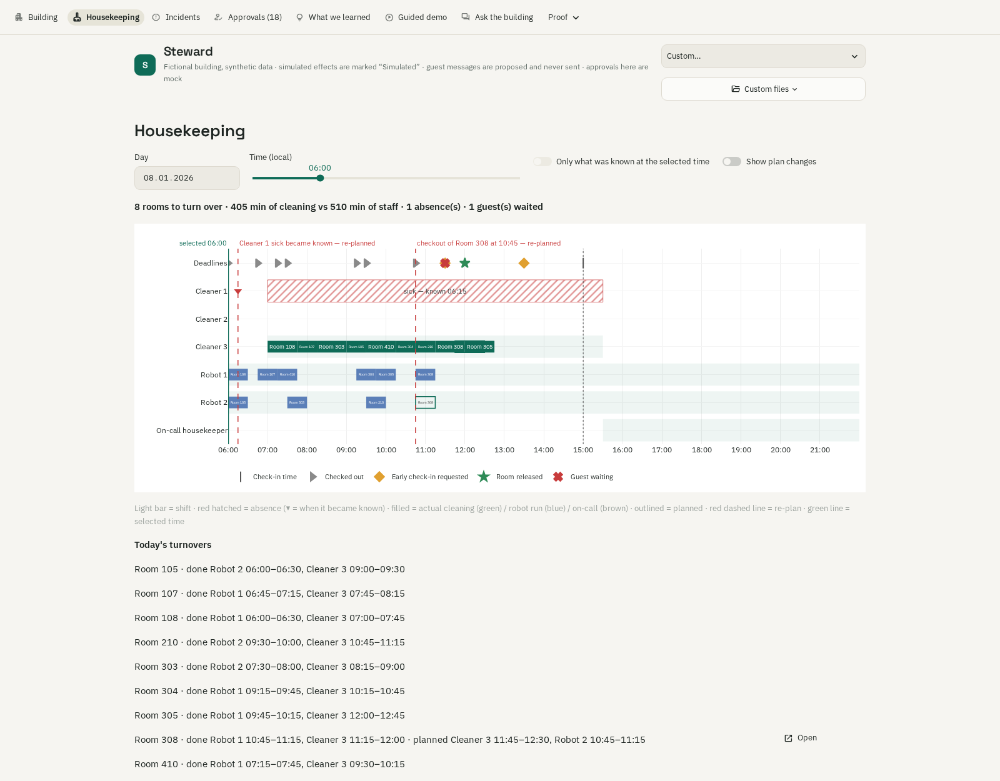

# Demo script: Steward (PLATO-40 viewer)

The **Guided demo** page is the live demo and the script for the 3-minute video. It has 8 steps on the real pages,
with Back / Next and one or two sentences to say per step. The talking points are in
[`viewer/tour.toml`](../viewer/tour.toml), so you can edit them without touching code. Everything is an offline
replay of the fictional PLATO-40 dataset:
- guest messages are **proposed, never sent**;
- effects are **Simulated**;
- Approve / Reject is a **mock** that only writes `out/approvals.json`;
- "guest consent needed" means needed, **not granted**.

## Start

```bash
pip install -r viewer/requirements.txt
python run.py data/quickstart --out out/qs.jsonl
streamlit run viewer/app.py -- --decisions out/qs.jsonl --data data/quickstart     # http://localhost:8501
# server:  docker compose up --build viewer      (runs the pipeline first if out/qs.jsonl is missing)
```

The dataset picker (top right) switches between Quickstart, Dev (the root `decisions.jsonl` or `out/dev.jsonl`)
and **Custom…**, which takes any decisions file plus data folder, e.g. the holdout. Optional extras:
- `python scripts/summarise_incidents.py out/qs.jsonl --data data/quickstart` adds incident summaries
  (template summaries without a key).
- **Ask the building** answers questions with cached and offline answers when no `LLM_API_KEY` is set.

**Before the demo:** open the viewer once. The first load warms the cache: dev takes about 3–4 s, after that
0.1–0.2 s, and every page switch is under 1 s. Then open **Guided demo** and leave it on step 1.

## The tour (≈ 20 s per step)

| # | Step | Page shown | What to point at |
|---|---|---|---|
| 1 | The building at a glance | Building at the first incident | Floor plan at one 15-min moment, using only what was known then: red dot = open incident, "Needs attention now" card, plant and staff as known |
| 2 | A water leak | Room 104 story | Water-rate chart with numbered red markers (what we did, and when) and the yellow incident period; inspection is autonomous, water shut-off needs approval + guest consent |
| 3 | Heat pump in a cold snap | Heating story | Efficiency below what the weather explains; service ordered; comfort effect **Simulated** |
| 4 | Early check-in vs tight cleaning | Turnaround story | Re-plan with staff who are really available; the room is released only when clean |
| 5 | Event weekend and a sick cleaner | Busy-weekend story | Arrival peak visible days ahead; re-plan when the sick call becomes known; extra staff → **Approvals** (mock) |
| 6 | Ventilation filter vs a data gap | Filter story | Pressure trend before the **grey gap = unknown, not fixed**; contractor needs approval because the technician is away |
| 7 | What we learned | Top insight cards | PLATO-40 design and CLARA operations lessons; benefits are estimates |
| 8 | Proof | Proof | Press **Run check** → `validate.py: PASS`; detection vs labels (dev aid) and BMS alarms vs us |

Deep link to any step: `http://localhost:8501/tour?tour=N`. On dev or holdout runs, which have no hand labels,
each step shows the most severe episode of that scenario.

## Fallback click path (if the tour misbehaves)

You can reach every hero incident in ≤ 3 clicks from the start screen:

1. **Building**: click the red-dot room, or the **Open** button in "Needs attention now" → the incident story.
2. **Incidents** → the filter chips (Water leak, Heating & comfort, Room turnaround, Busy weekend,
   Ventilation filter) → click a card → the story: what we saw (chart), why we think so, what we did, what happens
   next. "Technical details" at the bottom shows the raw decisions.
3. **Approvals (n)**: grouped per incident, with mock Approve / Reject. The counter in the navigation updates.
4. **What we learned**: insight cards with evidence and uncertainty.
5. **Proof**: **Run check** (validator), detection table, BMS vs us, data quality, downloads (decisions and
   insights).
6. **Ask the building**: a suggested question, e.g. "What happened in Room 104?", gives an answer with
   numbered sources that link to the story.

**30-second question:** "What happened in Room 104 and what did the system do?" Answer it with **Incidents →
Water leak → Room 104**. The story headline says it: a loud leak in vacant Room 104, flagged 45 min after it
started, inspection requested, water shut-off waiting for approval and guest consent.

## Housekeeping: who cleans what, when

**Housekeeping** (after Building) shows one local day as a timeline: one lane per cleaner, robot and the on-call
housekeeper, with shifts, absences, planned (outlined) and actual (filled) cleanings, the deadline row (check-in
15:00, early check-in requests, guests waiting, rooms released) and red re-plan lines. "Only what was known at the
selected time" is on by default; turn it off to see how the day really went, and turn on "Show plan changes" to
see the earlier plans that were replaced. Room turnaround and busy-weekend stories show the same chart under
"The day's plan".

- **Thu 8 Jan** (quickstart, `?t=2026-01-08T05:00Z` = 06:00): at 06:00 Cleaner 1 is still on shift and only one
  plan exists. Slide to 06:15: Cleaner 1 is shown sick (known 06:15), the re-plan line appears at exactly that time
  and Room 308 moves to Cleaner 3. Turn the toggle off: a robot floor pre-clean runs before Cleaner 3, and Room 308
  is released at 12:00, before check-in.
- **Sat 24 Jan** (quickstart, busy weekend): Cleaner 1 sick, the 06:30 daily re-plan, robots pre-cleaning vacated
  rooms, and two on-call calls (Rooms 101 and 306). The summary says "more work than staff".



## Honesty lines to say out loud

- "Nothing is sent or executed: messages are proposals, approvals are mock, effects are simulated."
- "Grey means we had no data: unknown, never treated as normal."
- "Every decision only uses data that was known at that moment; the Building view replays exactly that."
